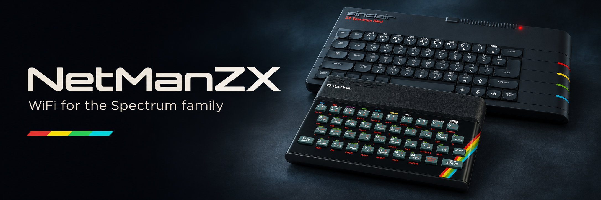
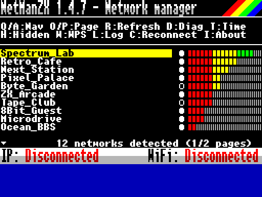
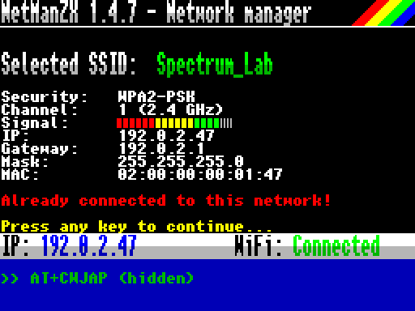
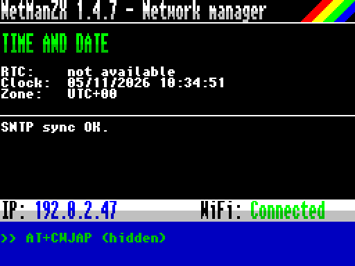
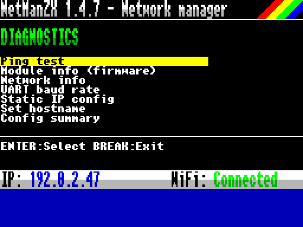
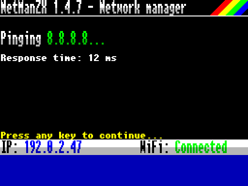
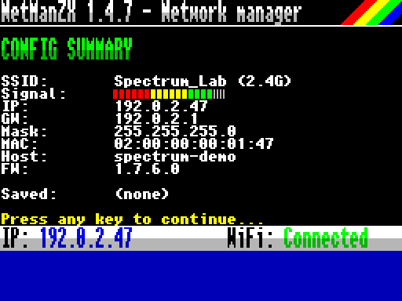
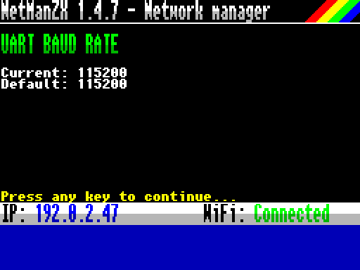
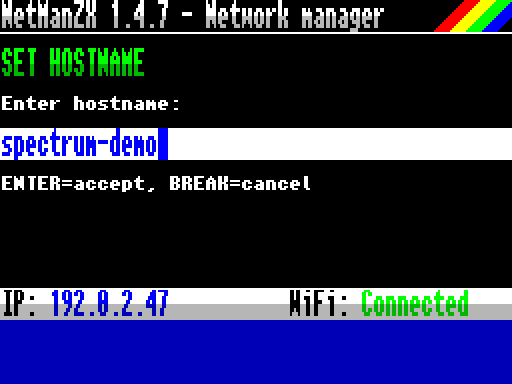
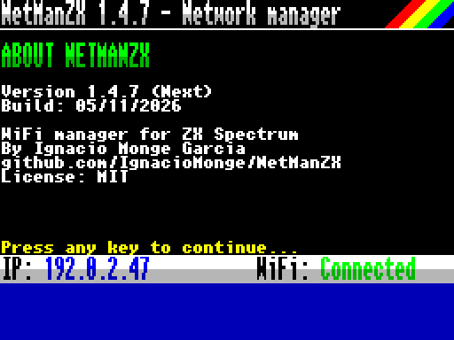

<p align="center">
  
</p>

# NetManZX

<p align="center">
  <strong>WiFi network manager for ZX Spectrum</strong><br>
  ZX-Uno / divMMC · AY-UART · ZX Spectrum Next
</p>

<p align="center">
  <a href="READMEsp.md">Español</a> ·
  <a href="https://github.com/IgnacioMonge/NetManZX/releases/tag/v1.4.7">Download v1.4.7</a> ·
  <a href="CHANGELOG.md">Changelog</a>
</p>

---

Scan WiFi networks, connect your Spectrum and check the link from one application. NetManZX uses an ESP8266 module connected through a ZX-Uno-compatible, AY-UART or Spectrum Next interface.

**Current release: 1.4.7**, available for UNO, AY-UART and Spectrum Next.

## Why NetManZX

| | |
| --- | --- |
| **Networks** | The 50 strongest access points, sorted by signal strength; manual connection to hidden networks |
| **Connect** | Password, WPS and reconnection to credentials saved on SD on UNO/Next |
| **Diagnostics** | Ping, firmware, IP/MAC, baud rate, static IP, hostname and configuration summary |
| **Interface** | Double-height text, signal bars, scroll indicators and UART log |
| **Distribution** | TAP for UNO/AY; one self-contained NEX for Spectrum Next |

## What's new in 1.4.7

- **Time and date:** T opens RTC status and clock settings on Spectrum Next and UNO TAP. Y synchronizes through SNTP; Z selects a whole-hour UTC offset from -12 to +14. Settings are saved in `NETTIME.CFG`.
- **More networks:** retain the 50 strongest access points, with a single active scan pass and a fallback for older ESP firmware.
- **Clearer signal meters:** bright red/yellow/green bars show measured strength; dim stripes show the remaining range. Detail and configuration screens align their values and meters.
- **Smoother interaction:** list rows, menus, counters and text editors update only changing areas; queued keys take priority over optional background work.
- **Safer cancellation and recovery:** improved BREAK handling, bounded UART recovery, scan parsing and connection details; quitting now asks for confirmation.

See the [1.4.7 changelog](CHANGELOG.md#v147---2026-11-05) for all changes since 1.4.6.

## Contents

- [What's new in 1.4.7](#whats-new-in-147)
- [Platforms and requirements](#platforms-and-requirements)
- [Download](#download)
- [Installation](#installation)
- [Quick start](#quick-start)
- [Gallery](#gallery)
- [Features](#features)
- [Controls](#controls)
- [Time and date](#time-and-date)
- [Connection recovery](#connection-recovery)
- [Build from source](#build-from-source)
- [Credits and license](#credits-and-license)

## Platforms and requirements

- ZX Spectrum (48K or higher) or compatible
- ESP8266-based WiFi module:
  - **ZX-Uno**: Built-in UART (default target)
  - **AY-UART**: UART implemented through the AY-3-8912 I/O port
  - **ZX Spectrum Next**: Hardware UART with FIFO
- TAP-compatible loading method for UNO/AY (divMMC, esxDOS, emulator, or tap2wav for tape); NextZXOS for the native Next NEX
- SD access through esxDOS/NextZXOS for saved credentials and clock settings; an RTC is optional for the Time screen

## Download

Download ready-to-load binaries from [release v1.4.7](https://github.com/IgnacioMonge/NetManZX/releases/tag/v1.4.7). Choose the file for your interface:

| Target | File | Description |
|--------|------|-------------|
| UNO | [`netmanzx-uno.tap`](https://github.com/IgnacioMonge/NetManZX/releases/download/v1.4.7/netmanzx-uno.tap) | ZX-Uno / DivMMC |
| AY | [`netmanzx-ay.tap`](https://github.com/IgnacioMonge/NetManZX/releases/download/v1.4.7/netmanzx-ay.tap) | AY-UART |
| NEXT | [`netmanzx-next.nex`](https://github.com/IgnacioMonge/NetManZX/releases/download/v1.4.7/netmanzx-next.nex) | ZX Spectrum Next (native NEX) |

The 1.4.7 distribution retains all three targets, including AY-UART as a TAP file.

## Installation

**TAP (tape/emulators):**
Simply load the TAP file - the BASIC loader will auto-run and load the program automatically.

**NEX (Next):**
Copy `netmanzx-next.nex` to your SD card and launch it from the Next file browser.

## Quick start

1. **Load the program** on your Spectrum
2. **Wait for network scan** - available networks will appear in a list
3. **Navigate** using cursor keys (up/down) or Q/A, O/P for page up/down
4. **Select a network** with ENTER - a detail screen shows security, channel, and signal
5. **Enter password** (if required) - use UP arrow to toggle password visibility
6. **Wait for connection** — BREAK cancels; failures show a reason
7. **Access diagnostics** by pressing D from the network list

## Gallery

*Emulator captures of NetManZX 1.4.7: Time on UNO, other screens on Spectrum Next. Networks, SSIDs and responses are simulated test data. Images show only the Spectrum display, without window frames or desktop borders.*

| | | |
|:---:|:---:|:---:|
| [](images/1.4.7/release/01_network_list.png) | [](images/1.4.7/release/02_network_details.png) | [](images/1.4.7/release/03_time.png) |
| *Network list* | *Network details* | *Time and date (UNO)* |
| [](images/1.4.7/release/04_diagnostics.png) | [](images/1.4.7/release/05_ping.png) | [](images/1.4.7/release/06_config_summary.png) |
| *Diagnostics* | *Ping test* | *Configuration summary* |
| [](images/1.4.7/release/07_uart_baud.png) | [](images/1.4.7/release/08_hostname.png) | [](images/1.4.7/release/09_about.png) |
| *UART baud rate* | *Hostname editor* | *About* |

## Features

- **Find nearby networks:** browse up to 50 access points sorted by signal strength, with security and channel information before connecting.
- **Connect to visible or hidden networks:** choose a network or enter its name manually, supply a password when needed, or use WPS push-button setup.
- **Save and reconnect (UNO/Next):** keep one network's credentials on SD and reconnect without typing the password again.
- **Configure your connection:** set a static IP address and a custom hostname for the WiFi module.
- **Inspect network details:** view the current network, IP address, gateway, subnet mask and MAC address.
- **Troubleshoot connection problems:** run a ping test to an address of your choice, inspect WiFi module settings and see why a connection failed.
- **Monitor connection status:** see when the connection drops and when the WiFi module reconnects.
- **Synchronize date and time (UNO TAP/Next):** get the time over WiFi, choose a UTC offset and update a compatible real-time clock.

## Controls

| Key | Action |
|-----|--------|
| Up/Down or Q/A | Navigate network list |
| Left/Right or O/P | Previous/next page |
| ENTER | Select network / Confirm |
| BREAK | Cancel / Back; quit from the main menu |
| H | Connect to hidden network (manual SSID entry) |
| X | Disconnect from current network |
| D | Diagnostics menu |
| R | Rescan networks |
| L | Toggle UART debug log |
| W | WPS push-button connect |
| C | Reconnect to the saved network (UNO/NEXT) |
| S | Save credentials after connection (UNO/NEXT) |
| T | Time and date (Next / UNO TAP) |
| I | About screen |

From the main menu, BREAK asks for confirmation; Y returns to BASIC on UNO/AY and any other key resumes the list. On Next it restarts the machine; it does not restore the previous NextZXOS session.

## Time and date

On **Spectrum Next and UNO TAP**, press T from the network list. The screen shows the detected RTC, clock and UTC offset; the clock refreshes once a second while the screen is open. AY TAP and non-TAP UNO builds do not include Time.

- **Y — Sync SNTP:** connect to WiFi first. NetManZX requests network time through the ESP, updates a writable RTC when detected, and saves the synchronized fields and offset. RTC-write and file-save failures are reported separately.
- **Z — Zone:** enter a whole-hour UTC offset from `-12` to `+14`. This is a fixed offset; adjust it yourself for daylight-saving changes.
- **BREAK — Exit:** return to the network list. BREAK also cancels the zone editor and supported AT operations.

Clock settings use `/SYS/CONFIG/NETTIME.CFG` on UNO and `c:/sys/config/nettime.cfg` on Next, separate from WiFi credentials in `NETMAN.CFG`. An RTC is optional: without one the screen can show the last saved synchronization, which is not a continuously running clock across restarts. RTC support includes esxDOS/NextZXOS date services, PCF8563 on UNO and DS1307 on Next.

## Connection recovery

NetManZX monitors ESP connection events and periodically checks the link. Scans and connection commands temporarily pause navigation; BREAK response varies with the UART backend. A background scan discards pending input on completion, but a held key can still repeat.

Next can recover common baud-rate mismatches automatically. On UNO/AY, check the module's baud rate and interface setup if startup cannot communicate with the ESP.

## Build from source

### Prerequisites

- [SjASMPlus](https://github.com/z00m128/sjasmplus) Z80 Cross-Assembler v1.20+
- GNU Make

### Compilation

```bash
# Build for ZX-Uno / DivMMC (default)
make uno

# Build for AY-UART
make ay

# Build for ZX Spectrum Next
make next

# Build all targets
make all
```

Build outputs are `build/netmanzx-uno.tap`, `build/netmanzx-ay.tap` and `build/netmanzx-next.nex`. `make all` builds AY, Next and then UNO. Single-target builds clear previous build outputs.

AY supports TAP only; AY +3DOS/DOT variants are rejected.

## Credits and license

NetManZX is based on [netman-zx](https://github.com/nihirash/netman-zx), by **Alex Nihirash**.

NetManZX enhancements: **M. Ignacio Monge Garcia — 2025–2026**.

Released under the [MIT license](LICENSE). See the [changelog](CHANGELOG.md) for the version history.

*Made with love for the ZX Spectrum community.*
