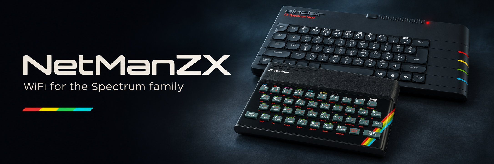
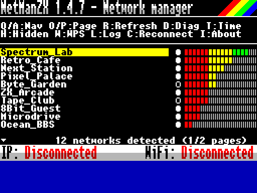
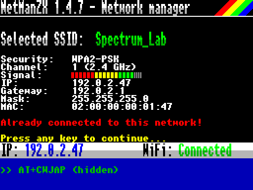
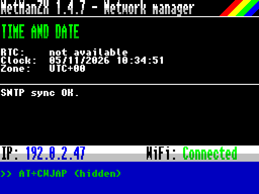
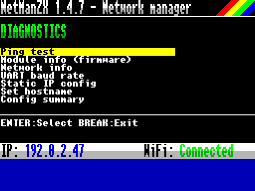
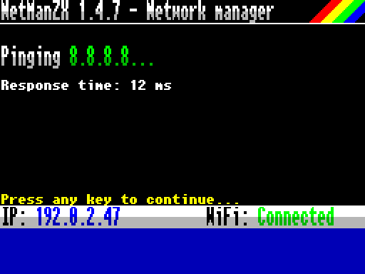
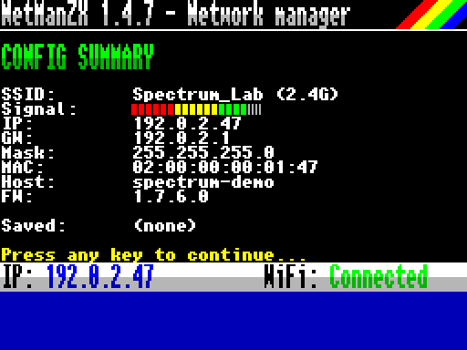
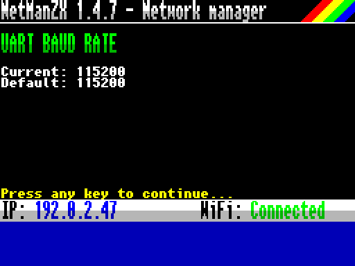
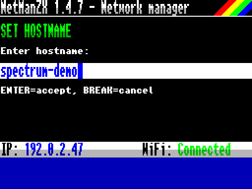
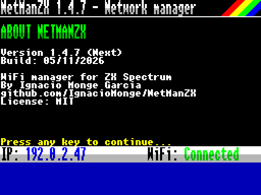

<p align="center">
  
</p>

# NetManZX

<p align="center">
  <strong>Gestor de redes WiFi para ZX Spectrum</strong><br>
  ZX-Uno / divMMC · AY-UART · ZX Spectrum Next
</p>

<p align="center">
  <a href="README.md">English</a> ·
  <a href="https://github.com/IgnacioMonge/NetManZX/releases/tag/v1.4.7">Descargar v1.4.7</a> ·
  <a href="CHANGELOG.md">Historial de cambios</a>
</p>

---

Escanea redes WiFi, conecta tu Spectrum y comprueba el enlace desde una sola aplicación. NetManZX utiliza un módulo ESP8266 conectado mediante una interfaz compatible con ZX-Uno, AY-UART o Spectrum Next.

**Versión actual: 1.4.7**, disponible para UNO, AY-UART y Spectrum Next.

## Qué ofrece NetManZX

| | |
| --- | --- |
| **Redes** | Los 50 puntos de acceso más potentes, ordenados por señal; conexión manual a redes ocultas |
| **Conexión** | Contraseña, WPS y reconexión a credenciales guardadas en SD en UNO/Next |
| **Diagnósticos** | Ping, firmware, IP/MAC, baudios, IP estática, hostname y resumen de configuración |
| **Interfaz** | Texto en doble altura, barras de señal, indicadores de desplazamiento y log UART |
| **Distribución** | TAP para UNO/AY; un único NEX para Spectrum Next |

## Novedades de 1.4.7

- **Fecha y hora:** T abre el estado del RTC y los ajustes del reloj en Spectrum Next y UNO TAP. Y sincroniza mediante SNTP; Z selecciona un desfase UTC de horas enteras entre -12 y +14. Los ajustes se guardan en `NETTIME.CFG`.
- **Más redes:** conserva los 50 puntos de acceso más potentes, con una sola pasada de escaneo activo y una alternativa para firmware ESP antiguo.
- **Medidores de señal más claros:** las barras brillantes rojas, amarillas y verdes muestran la intensidad; las franjas tenues completan la escala. Las pantallas de detalle y configuración alinean valores y medidores.
- **Interacción más fluida:** filas, menús, contadores y editores actualizan solo las zonas que cambian; las teclas pendientes tienen prioridad sobre las tareas de fondo opcionales.
- **Cancelación y recuperación más seguras:** mejoras en BREAK, recuperación UART acotada, análisis del escaneo y detalles de conexión; salir ahora pide confirmación.

Consulta el [historial de 1.4.7](CHANGELOG.md#v147---2026-11-05) para ver todos los cambios desde 1.4.6.

## Índice

- [Novedades de 1.4.7](#novedades-de-147)
- [Plataformas y requisitos](#plataformas-y-requisitos)
- [Descarga](#descarga)
- [Instalación](#instalación)
- [Inicio rápido](#inicio-rápido)
- [Galería](#galería)
- [Funciones](#funciones)
- [Controles](#controles)
- [Fecha y hora](#fecha-y-hora)
- [Recuperación de la conexión](#recuperación-de-la-conexión)
- [Compilar desde el código fuente](#compilar-desde-el-código-fuente)
- [Créditos y licencia](#créditos-y-licencia)

## Plataformas y requisitos

- ZX Spectrum (48K o superior) o compatible
- Modulo WiFi basado en ESP8266:
  - **ZX-Uno**: UART integrado (target por defecto)
  - **AY-UART**: UART implementada mediante el puerto de E/S del AY-3-8912
  - **ZX Spectrum Next**: UART hardware con FIFO
- Método de carga compatible con TAP para UNO/AY (divMMC, esxDOS, emulador o tap2wav para cinta); NextZXOS para el NEX nativo de Next
- Acceso a SD mediante esxDOS/NextZXOS para guardar credenciales y ajustes del reloj; el RTC es opcional para la pantalla de hora

## Descarga

Descarga los binarios listos para cargar de la [versión 1.4.7](https://github.com/IgnacioMonge/NetManZX/releases/tag/v1.4.7). Elige el archivo para tu interfaz:

| Target | Archivo | Descripcion |
|--------|---------|-------------|
| UNO | [`netmanzx-uno.tap`](https://github.com/IgnacioMonge/NetManZX/releases/download/v1.4.7/netmanzx-uno.tap) | ZX-Uno / DivMMC |
| AY | [`netmanzx-ay.tap`](https://github.com/IgnacioMonge/NetManZX/releases/download/v1.4.7/netmanzx-ay.tap) | AY-UART |
| NEXT | [`netmanzx-next.nex`](https://github.com/IgnacioMonge/NetManZX/releases/download/v1.4.7/netmanzx-next.nex) | ZX Spectrum Next (NEX nativo) |

La distribución 1.4.7 conserva los tres targets, incluido AY-UART en formato TAP.

## Instalación

**TAP (cinta/emuladores):**
Simplemente carga el archivo TAP - el cargador BASIC se ejecutara automaticamente y cargara el programa.

**NEX (Next):**
Copia `netmanzx-next.nex` a la tarjeta SD y ejecútalo desde el navegador de archivos del Next.

## Inicio rápido

1. **Carga el programa** en tu Spectrum
2. **Espera al escaneo de redes** - las redes disponibles apareceran en una lista
3. **Navega** usando las teclas de cursor (arriba/abajo) o Q/A, O/P para pagina arriba/abajo
4. **Selecciona una red** con ENTER - una pantalla de detalle muestra seguridad, canal y senal
5. **Introduce la contrasena** (si es necesaria) - usa flecha arriba para mostrar/ocultar contrasena
6. **Espera a la conexión** — BREAK cancela; los fallos muestran su motivo
7. **Accede a diagnosticos** pulsando D desde la lista de redes

## Galería

*Capturas en emulador de NetManZX 1.4.7: reloj en UNO y demás pantallas en Spectrum Next. Las redes, los SSID y las respuestas son datos de prueba simulados. Las imágenes muestran solo la pantalla del Spectrum, sin marcos de ventana ni bordes del escritorio.*

| | | |
|:---:|:---:|:---:|
| [](images/1.4.7/release/01_network_list.png) | [](images/1.4.7/release/02_network_details.png) | [](images/1.4.7/release/03_time.png) |
| *Lista de redes* | *Detalles de red* | *Fecha y hora (UNO)* |
| [](images/1.4.7/release/04_diagnostics.png) | [](images/1.4.7/release/05_ping.png) | [](images/1.4.7/release/06_config_summary.png) |
| *Diagnósticos* | *Prueba de ping* | *Resumen de configuración* |
| [](images/1.4.7/release/07_uart_baud.png) | [](images/1.4.7/release/08_hostname.png) | [](images/1.4.7/release/09_about.png) |
| *Velocidad UART* | *Editor de hostname* | *Acerca de* |

## Funciones

### Gestion de Redes

- **Escaneo de redes**: Conserva los 50 puntos de acceso WiFi más potentes, ordenados por señal, con reintentos si falla el escaneo. Los puntos de acceso con el mismo nombre permanecen separados; la selección conecta al punto elegido
- **Detección al arrancar**: Comprueba el módulo WiFi e informa de problemas de inicio, recuperación y escaneo
- **Soporte de Redes Ocultas**: Introduce manualmente el SSID de redes que no emiten su nombre
- **Deteccion Inteligente de Conexion**: Al iniciar, detecta si ya esta conectado a una WiFi y actualiza la barra de estado; el arranque en frio va directo al menu principal + primer escaneo en todos los casos. Si la red "ya conectada" se selecciona desde la lista, una pantalla de detalle muestra su informacion con un aviso en rojo `Already connected to this network!`
- **Pantalla de informacion de conexion**: Pulsa ENTER sobre la red ya conectada para ver IP, gateway, mascara de subred y direccion MAC
- **Guardar y reconectar** (solo UNO/NEXT): Guarda credenciales en SD (`/SYS/CONFIG/NETMAN.CFG` en divMMC, `c:/sys/config/netman.cfg` en Next). C ofrece reconectar a la red guardada; S guarda tras una conexión correcta. La red guardada aparece en cyan
- **Entrada de Contrasena**: Soporte completo de teclado con opcion de mostrar/ocultar, entrada en doble altura con edicion de cursor (flechas izquierda/derecha)
- **Soporte WPS**: Conexión por pulsación con W y cancelación con BREAK, conservando la política de conexión automática guardada en el ESP
- **Opcion de Desconexion**: Desconecta de la red actual con dialogo de confirmacion, sin salir de la aplicacion
- **Monitorizacion de Estado en Tiempo Real**: Detecta automaticamente caidas y reconexiones mediante parseo asincrono de eventos del ESP
- **Diagnostico de fallos de conexion**: Mensajes especificos de error: contrasena incorrecta, AP no encontrado, timeout o conexion rechazada
- **Cancelación con BREAK**: Cancela intentos de conexión y operaciones AT. El tiempo de respuesta depende del hardware y de la operación

### Menu de Diagnosticos

1. **Ping test** - Probar conectividad con IP configurable (por defecto: 8.8.8.8)
2. **Module info** - Mostrar version del firmware del ESP8266 y conjunto de comandos AT
3. **Network info** - Mostrar direccion IP y direccion MAC actual
4. **Velocidad UART** - Muestra por separado la velocidad actual y la predeterminada guardada
5. **Static IP** - Configurar direccion IP estatica, gateway y mascara de subred
6. **Hostname** - Establecer un nombre de host personalizado para el modulo ESP
7. **Config summary** - Ver todos los ajustes WiFi actuales de un vistazo (SSID, IP, MAC, hostname, firmware, red guardada, version de la app)

### Interfaz de Usuario

- **Texto en doble altura**: Banner, estado, entradas y mensajes grandes, con actualizaciones más suaves de la lista de redes
- **Detalle de red**: Consulta el nombre, la seguridad, el canal y la señal antes de conectar
- **Pantalla de conexion**: "Connecting to..." muestra el SSID en doble altura amarillo con contador de intentos
- **Badge arcoiris**: Triangulo decorativo con transiciones de color en el banner
- **Barras de señal RSSI**: Medidores de nueve celdas con barras brillantes rojas, amarillas y verdes y franjas tenues para el resto de la escala, con glifos personalizados de círculo cerrado/abierto
- **Barra de estado anti-parpadeo**: Renderizado por sobreescritura directa con actualizaciones agrupadas que elimina el parpadeo visual
- **Indicadores de scroll**: Flechas visuales que indican cuando hay mas redes disponibles
- **Click de tecla audible**: Feedback sonoro claro en cada pulsacion durante la entrada de texto

### Otros

- **Pantalla de arranque**: Logo de carga en todos los equipos, con imagen en color Layer 2 en Next. Los mensajes descriptivos informan de la inicialización y recuperación del WiFi
- **Pantalla Acerca de** (tecla I): Muestra version, fecha de compilacion, autor, URL de GitHub y licencia
- **Log UART**: Se activa con L; un indicador rojo muestra su estado. Los comandos se registran en pantalla al terminar el intercambio, con un aviso si el texto queda truncado
- **Fuente integrada**: Texto compacto de seis píxeles de ancho, sin archivo de fuente externo para ejecutar el programa
- **Tres backends UART**: Soporta hardware ZX-Uno, AY-UART y ZX Spectrum Next
- **Detección automática de baudios** (solo Next): Prueba 1152000, 2000000, 9600 y 57600 baudios si el ESP no responde a 115200. Restablece 115200 para la sesión sin cambiar la velocidad guardada; reinicia el ESP si la recuperación lo requiere
- **Formato NEX** (solo Next): Binario nativo `.nex` para arranque directo sin menu de seleccion de modo

## Controles

| Tecla | Accion |
|-------|--------|
| Arriba/Abajo o Q/A | Navegar lista de redes |
| Izquierda/Derecha u O/P | Página anterior/siguiente |
| ENTER | Seleccionar red / Confirmar |
| BREAK | Cancelar / Volver; salir desde el menú principal |
| H | Conectar a red oculta (introducir SSID manualmente) |
| X | Desconectar de la red actual |
| D | Menu de diagnosticos |
| R | Reescanear redes |
| L | Alternar log de depuracion UART |
| W | Conexion WPS por pulsacion |
| C | Reconectar a la red guardada (UNO/NEXT) |
| S | Guardar credenciales tras conexion exitosa (UNO/NEXT) |
| T | Fecha y hora (Next / UNO TAP) |
| I | Pantalla Acerca de |

Desde el menú principal, BREAK pide confirmación; Y vuelve a BASIC en UNO/AY y cualquier otra tecla regresa a la lista. En Next reinicia la máquina; no restaura la sesión anterior de NextZXOS.

## Fecha y hora

En **Spectrum Next y UNO TAP**, pulsa T desde la lista de redes. La pantalla muestra el RTC detectado, el reloj y el desfase UTC; el reloj se actualiza cada segundo mientras la pantalla está abierta. AY TAP y las compilaciones UNO sin TAP no incluyen esta función.

- **Y — Sync SNTP:** conecta primero a WiFi. NetManZX solicita la hora de red mediante el ESP, actualiza el RTC si detecta uno escribible y guarda los campos sincronizados y el desfase. Los fallos al escribir el RTC y al guardar el archivo se notifican por separado.
- **Z — Zone:** introduce un desfase UTC de horas enteras entre `-12` y `+14`. Es un desfase fijo; debes ajustarlo cuando cambie el horario de verano.
- **BREAK — Salir:** vuelve a la lista de redes. BREAK también cancela el editor de zona y las operaciones AT compatibles.

Los ajustes del reloj usan `/SYS/CONFIG/NETTIME.CFG` en UNO y `c:/sys/config/nettime.cfg` en Next, separados de las credenciales WiFi de `NETMAN.CFG`. El RTC es opcional: sin él se puede mostrar la última sincronización guardada, que no constituye un reloj en marcha entre reinicios. Se admiten los servicios de fecha de esxDOS/NextZXOS, PCF8563 en UNO y DS1307 en Next.

## Recuperación de la conexión

NetManZX supervisa los eventos del ESP y comprueba periódicamente el enlace. Los escaneos y comandos de conexión pausan temporalmente la navegación; la respuesta a BREAK varía según el controlador UART. El escaneo automático descarta la entrada pendiente al terminar, pero una tecla mantenida puede repetirse.

Next puede recuperar automáticamente desajustes habituales de baudios. En UNO/AY, comprueba la velocidad del módulo y la configuración de la interfaz si el arranque no consigue comunicarse con el ESP.

## Compilar desde el código fuente

### Prerrequisitos

- [SjASMPlus](https://github.com/z00m128/sjasmplus) Z80 Cross-Assembler v1.20+
- GNU Make

### Compilar

```bash
# Compilar para ZX-Uno / DivMMC (por defecto)
make uno

# Compilar para AY-UART
make ay

# Compilar para ZX Spectrum Next
make next

# Compilar todos los targets
make all
```

Los archivos resultantes son `build/netmanzx-uno.tap`, `build/netmanzx-ay.tap` y `build/netmanzx-next.nex`. `make all` compila AY, Next y finalmente UNO. Las compilaciones de un solo target borran los resultados anteriores.

AY solo admite TAP; las variantes AY +3DOS/DOT se rechazan.

## Créditos y licencia

NetManZX está basado en [netman-zx](https://github.com/nihirash/netman-zx), de **Alex Nihirash**.

Mejoras de NetManZX: **M. Ignacio Monge Garcia — 2025–2026**.

Distribuido bajo la [licencia MIT](LICENSE). Consulta el [CHANGELOG](CHANGELOG.md) para el historial de versiones.

*Hecho con amor para la comunidad del ZX Spectrum.*
